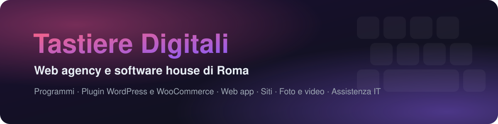

  

 

<h2 align="center">💼 I nostri programmi</h2>

Per l'ufficio, il negozio e lo studio. I dati restano sempre sui tuoi computer.

<table align="center">
<tr>
<td align="center" width="33%" valign="top">
 

<h3><a href="https://github.com/tastieredigitali/TD-Booking-Suite-per-Windows">TD Booking Suite</a></h3>
Prenotazioni, agenda e clienti per saloni, studi e attività. Un PC o un server per tutta la rete, il telefono e le prenotazioni online.
  

  
</td>
<td align="center" width="33%" valign="top">
 

<h3><a href="https://github.com/tastieredigitali/TD-Vexa-per-Windows">TD Vexa</a></h3>
Il gestionale del negozio: vendite, cassa, preventivi, ordini, assistenza e magazzino, con il sito WooCommerce collegato.
  

  
</td>
<td align="center" width="33%" valign="top">
 

<h3><a href="https://github.com/tastieredigitali/TD-Velo-per-Windows-e-Mac">TD Velo</a></h3>
Nasconde nomi, codici fiscali, IBAN e altri dati personali prima di dare un documento a un'IA, e li rimette al loro posto nella risposta.
  

  
</td>
</tr>
</table>

 

<h2 align="center">☁️ Self-hosted</h2>

Da installare sul proprio server, con Docker.

<table align="center">
<tr>
<td align="center" width="33%" valign="top">
 

<h3><a href="https://github.com/tastieredigitali/TiDiTalk">TiDiTalk</a></h3>
Videoconferenze per team e clienti: condivisione schermo, sala d'attesa, inviti via email.
  

  
</td>
<td align="center" width="33%" valign="top">
 

<h3><a href="https://github.com/tastieredigitali/SentinelTD">SentinelTD</a></h3>
Monitoraggio, manutenzione e sicurezza di tutti i siti WordPress e Joomla da un'unica dashboard.
  

  
</td>
<td align="center" width="33%" valign="top">
 

<h3><a href="https://github.com/tastieredigitali/CataSync">CataSync</a></h3>
Crea le schede prodotto WooCommerce partendo dal codice EAN e le pubblica sul sito.
  

  
</td>
</tr>
</table>

 

<h2 align="center">🎞️ Utilità gratuite per Windows</h2>

Nate nel nostro laboratorio di riversaggio di VHS, cassette, CD e DVD. Gratis per tutti.

<table align="center">
<tr>
<td align="center" width="33%" valign="top">
 

<h3><a href="https://github.com/tastieredigitali/VHSCapture">VHSCapture</a></h3>
Riversa VHS, Hi8 e MiniDV sul PC con un grabber USB, in MP4. Si ferma da solo a fine cassetta.
  
</td>
<td align="center" width="33%" valign="top">
 

<h3><a href="https://github.com/tastieredigitali/DvdRescue">DvdRescue</a></h3>
Recupera i video dai DVD non finalizzati e dai miniDVD delle videocamere e li salva in MP4.
  
</td>
<td align="center" width="33%" valign="top">
 

<h3><a href="https://github.com/tastieredigitali/mp4todvd">mp4todvd</a></h3>
Trasforma MP4, MKV e AVI in un DVD-Video con menu, pronto da masterizzare o come ISO.
  
</td>
</tr>
<tr>
<td align="center" width="33%" valign="top">
 

<h3><a href="https://github.com/tastieredigitali/DiscRipper">DiscRipper</a></h3>
Estrae i CD audio in MP3, FLAC e altri formati, con titoli e copertine trovati da solo.
  
</td>
<td align="center" width="33%" valign="top">
 

<h3><a href="https://github.com/tastieredigitali/TapeToMp3">Tape2MP3</a></h3>
Riversa le musicassette in MP3 e divide i brani da solo, trovando le pause.
  
</td>
<td align="center" width="33%" valign="top">
 

<h3><a href="https://github.com/tastieredigitali/Draftlite">DraftLite</a></h3>
Scrive sceneggiature in formato standard, con PDF, file Final Draft e Fountain.
  
</td>
</tr>
</table>

 

Fatto a Roma con ☕ e tastiere ben consumate · © Tastiere Digitali srls

